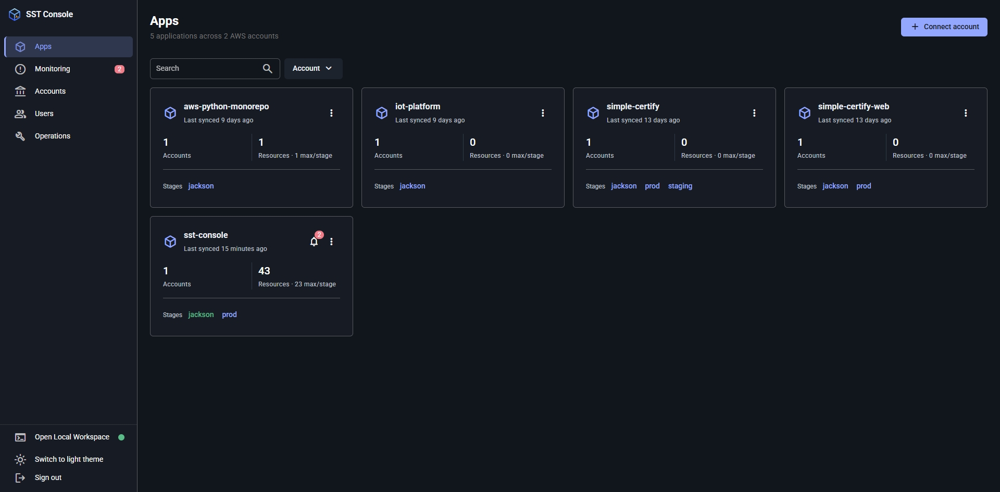
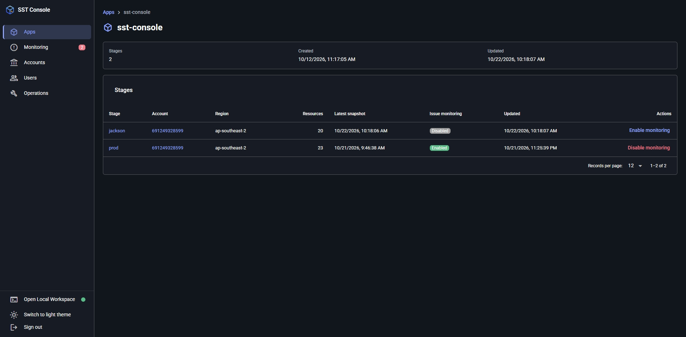
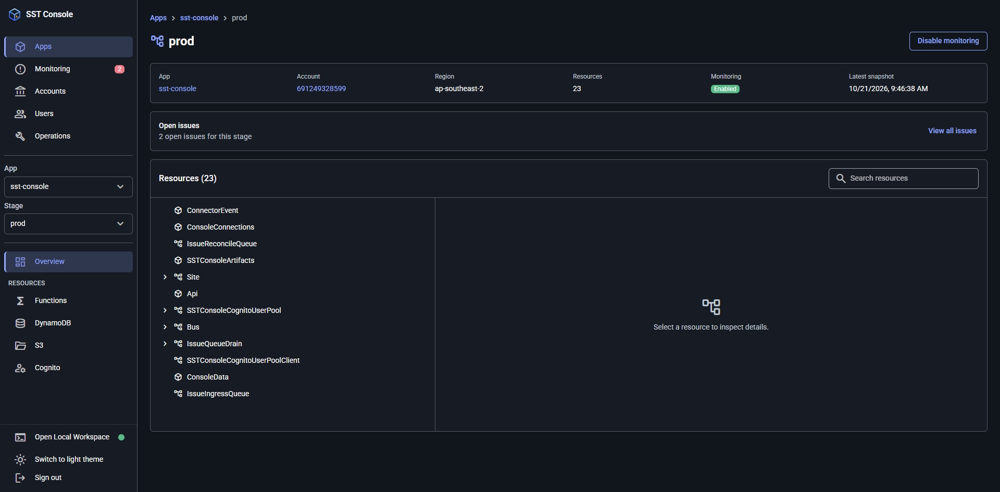
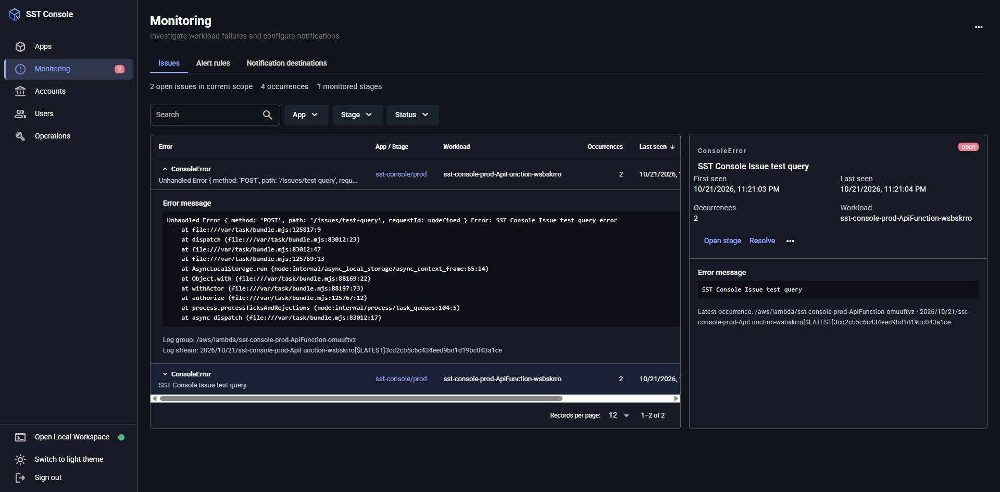
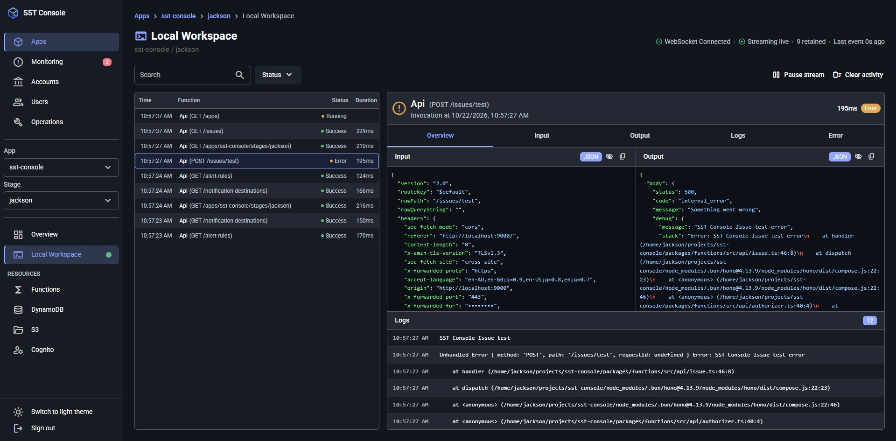

# SST Console

> **Early alpha.** Use isolated AWS accounts while connector permissions are broad and platform behavior is still changing.

SST Console is an experimental, self-hosted control plane for viewing SST v4 resources across AWS accounts in one organization. One installation is intended to run in a dedicated AWS control account and connect workload accounts through explicit cross-account roles.

Development is moving quickly. Features, APIs, infrastructure, data models, and security boundaries may change without notice. Deploy from a [stable release tag](#deploy), never the moving `main` branch.

## Status

### What works today

- Browse apps, stages, and resource metadata from connected AWS accounts.
- Investigate workload failures, configure alert rules, and route notifications through Console-managed Issue Monitoring.
- Inspect live cross-function invocation activity from a matching local `sst dev` session, including input, output, logs, errors, and duration.

### Not ready yet

- Function inspection for deployed stages.
- Resource actions and many operational workflows.
- Production hardening, least-privilege workload connectors, and stable upgrade or rollback guarantees.

## Screenshots

### Apps



### App stages



### Stage overview



### Issue Monitoring



### Local Workspace



## Self-hosting

Deploy one Console installation in a dedicated AWS control account. It can then connect workload accounts in your AWS organization.

### Prerequisites

- [Bun](https://bun.sh/)
- AWS credentials for control account, configured as an AWS CLI profile
- AWS permissions to create SST, Cognito, Lambda, DynamoDB, EventBridge, S3, and IAM resources

### Deploy

1. Open [GitHub Releases](https://github.com/JacksonBowe/sst-console/releases) and choose a stable release tag. Do not deploy the moving `main` branch.

2. Clone that release and install dependencies:

    ```bash
    git clone --branch vX.Y.Z --depth 1 https://github.com/JacksonBowe/sst-console.git
    cd sst-console
    bun install --frozen-lockfile
    ```

3. Create local configuration and set AWS profile and deployment region:

    ```bash
    cp console.config.example.ts console.config.ts
    ```

    Edit `console.config.ts`. Set `profile` to AWS CLI profile for control account and `region` to desired AWS region. Configure Cognito password policy if required. To serve Console on custom domain, follow [custom-domain deployment](docs/deploy-to-custom-domain.md).

4. Deploy Console:

    ```bash
    bun run deploy
    ```

5. Open `consoleUrl` from SST deployment output. Create initial user in deployed Cognito User Pool; see [authentication setup](docs/authentication.md).

6. Connect each workload account through **Connect account** in Console. This opens AWS CloudFormation using deployment-specific connector template. Connected accounts publish SST state changes to control account, letting Console index their apps and stages.

> **Warning**
> Current connector creates an installation-scoped `SSTConsoleRole-<control-account-id>-<stage-hash>` with `AdministratorAccess` in every connected workload account. Its IAM role description identifies the control account and Console stage. Review template and its permissions before deployment. Project is early work; use isolated, non-production AWS accounts only.

> **Issue monitoring limitation**
> Do not monitor same workload log groups from multiple Console installations. Each installation creates a CloudWatch Logs subscription filter; AWS allows at most two filters per log group. This can support an occasional production/live-dev comparison, but is not a supported operating model.

### Public artifacts

Console creates one public-read S3 bucket named `SSTConsoleArtifacts`. It distributes the workload-account connector CloudFormation template and issue-subscriber Lambda bundles from this bucket. Anyone can download its objects; do not treat their contents as private.

This bucket must contain only public deployment artifacts. Console data, configuration, credentials, secrets, state, and user uploads must never be stored in it. Public access is required so CloudFormation and Lambda in connected workload accounts can retrieve their deployment artifacts.

### Update

1. Open [GitHub Releases](https://github.com/JacksonBowe/sst-console/releases) and select release marked **Latest**. Do not select a **Pre-release**.

2. Read its release notes, then copy its tag name. For example, `v0.1.1`.

3. From existing Console checkout, fetch that release, check it out, and deploy it:

    ```bash
    git fetch --tags
    git checkout v0.1.1
    bun install --frozen-lockfile
    bun run deploy
    ```

Deploy only release tags. Do not run `git pull`, deploy `main`, or use an older release tag as a rollback procedure.

## Contributing

Contributions and feedback are welcome. Open a GitHub issue to discuss a feature or bug before starting a large change, then submit a pull request. Help is especially useful for AWS and IAM review, supported-resource coverage, UX, test coverage, and documentation.

See [CONTRIBUTING.md](CONTRIBUTING.md) for pull request and release requirements.

## How this differs from SST's official Console

This is an independent project exploring a different approach:

- **Self-hosted and single-tenant:** each installation is designed to run in its owner's AWS control account for one AWS organization.
- **Cross-account visibility first:** early work focuses on connecting workload accounts and indexing SST state metadata rather than reproducing every Console capability.
- **AWS-owned control plane:** the UI, API, authentication, operational index, and future integrations are intended to run within infrastructure owned by the installation operator.
- **Independent architecture:** the project is being designed around its self-hosted use case rather than compatibility with the official SST Console's APIs, workflows, or deployment model.

## Why a separate implementation?

The goal of this project is to explore a fully self-hosted Console that can run within an organization's own AWS infrastructure.

Building a separate implementation provides the freedom to design around that model from the beginning. In particular, the official Console's architecture includes external services such as PlanetScale, while this project aims to keep its control plane within the operator's AWS environment.

Starting independently also allows the project to evolve without requiring compatibility with the official Console's internal APIs, data model, or deployment architecture.

## Affiliation

SST Console is an independent community project. It is not affiliated with, endorsed by, sponsored by, or officially connected to Anomaly Innovations, Inc., the SST project, or any official SST product.

“SST” is used to describe the project's intended compatibility with SST v4.

## License

Licensed under [Apache-2.0](LICENSE).
