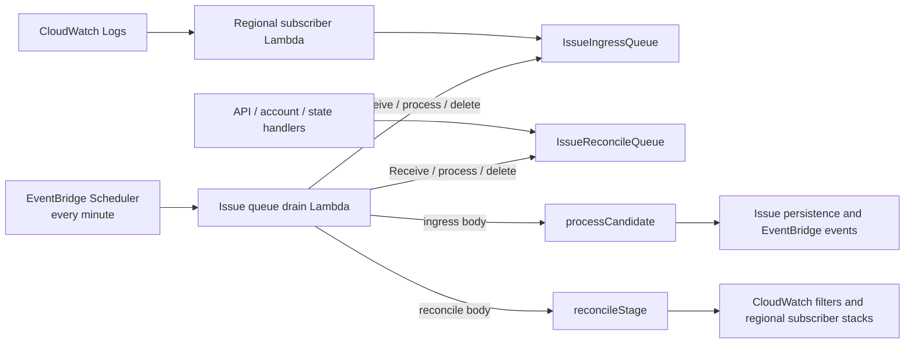

# Reduce SQS idle polling with scheduled Issue queue draining

## 1. Understanding

### Problem

SQS free-tier usage reached **854,255 / 1,000,000 requests**.

CloudWatch evidence is verified for all four Issue queues:

- `NumberOfEmptyReceives`
- Statistic: `Sum`
- Period: `1 minute`
- Value: about `30` per queue per minute

The observed queues were two ingress/reconcile pairs. The app is not deployed
currently, so this change does not need to preserve an existing deployed
resource, queue URL, or in-flight message backlog.

Current idle rate:

```text
4 queues × 30 empty receives/minute = 120 requests/minute
120 × 60 × 24 × 30 = 5,184,000 requests/month
```

Queue monitoring shows negligible `NumberOfMessagesSent`,
`NumberOfMessagesReceived`, and `NumberOfMessagesDeleted`. Idle Lambda-managed
SQS polling, rather than Issue message traffic, causes the usage.

### Verified current behavior

| Fact                                                                                                               | Evidence                                                                                   |
| ------------------------------------------------------------------------------------------------------------------ | ------------------------------------------------------------------------------------------ |
| Each stage creates separate ingress and reconcile SQS queues.                                                      | `infra/issue.ts`: `issueIngressQueue`, `issueReconcileQueue`                               |
| Each queue has a Lambda event-source subscription.                                                                 | `infra/issue.ts`: `issueReconcileQueue.subscribe(...)`, `issueIngressQueue.subscribe(...)` |
| Reconcile messages include delayed retries.                                                                        | `packages/core/src/issue/monitoring.ts`: `enqueueReconcile()` uses `DelaySeconds`          |
| Workload-account subscriber Lambdas send log-error candidates to ingress SQS.                                      | `packages/core/src/issue/subscriber-code.ts`                                               |
| Ingress processing validates messages and runs as system actor.                                                    | `packages/functions/src/events/issue-queue-drain.ts`                                       |
| Reconcile processing validates jobs and calls `Issue.Monitoring.reconcileStage()`.                                 | `packages/functions/src/events/issue-queue-drain.ts`                                       |
| Existing cross-account sender access is maintained by an ingress queue policy.                                     | `ensureIngressQueuePolicy()` in `packages/core/src/issue/monitoring.ts`                    |
| SST `4.17.1` supports `sst.aws.CronV2`, backed by EventBridge Scheduler; schedules continue after `sst dev` exits. | Installed `bun.lock`; SST CronV2 documentation and source                                  |
| `CronV2.enabled` defaults to `true`; `enabled: false` disables the Scheduler schedule.                             | SST CronV2 documentation and source                                                        |
| `CronV2.retries` configures EventBridge Scheduler target-delivery retries, not failed Lambda handler retries.      | SST CronV2 source; AWS Lambda async-invocation documentation                               |
| CronV2 invokes its Lambda asynchronously. Lambda retries failed asynchronous invocations twice by default.         | AWS Lambda async-invocation documentation                                                  |

### Goals and boundaries

Goals:

- retain separate ingress and reconcile queues;
- reduce idle SQS polling below free-tier limits;
- make Issue queue pickup cadence configurable;
- preserve SQS durability and delayed reconciliation.

Boundaries:

- Do not merge queues.
- Do not replace cross-account SQS ingress with EventBridge.
- Do not change DynamoDB models or Issue persistence.

### Assumptions

- Normal queue traffic remains low; current metrics support this.
- Scheduler delivery has one-minute precision, so pickup is approximately the
  configured schedule interval rather than a hard timing guarantee.
- Existing at-least-once delivery behavior remains acceptable.

## 2. Approach

Remove the two SQS-to-Lambda event-source mappings in each stage. Add one
EventBridge Scheduler-triggered Lambda per stage, running at configured
cadence. It polls both queues directly, processes successful messages, and
deletes only successful messages.

This keeps SQS as the durable transport and preserves existing producer payloads.
It removes permanently active Lambda pollers, which are the source of idle SQS
requests.

Expected idle request rate per active application stage with the default
five-minute cadence:

```text
2 queues × 1 ReceiveMessage/5 minutes
= 0.4 requests/minute
= 17,280 empty receives/month
```

If two application stages are active, this is 34,560 empty receives/month:
approximately a 99% reduction from the observed 5.184M idle requests/month.
These figures cover idle receives only; normal sends, busy-queue receives, and
batch deletes add SQS requests.

### Design decisions

1. **Keep queues separate.** Ingress and reconciliation have distinct message
   contracts and operational behavior. Consolidation is unnecessary for the
   stated cost target.
2. **One scheduled worker per stage polls both queues concurrently.** A slow
   reconciliation batch must not delay ingress polling.
3. **Use immediate `ReceiveMessage` calls.** Configured Scheduler cadence supplies
   the wait; long polling would add Lambda execution time without reducing
   scheduled idle request count.
4. **Leave failed messages undeleted.** SQS visibility timeout provides retry;
   successful sibling messages are deleted to avoid needless replay.
5. **Disable both retry layers.** Set CronV2 Scheduler delivery retries and
   Lambda asynchronous-invocation retries to zero. The next schedule invocation
   retries retained SQS messages; neither retry system is needed for message
   processing.
6. **Use SQS visibility for overlap protection.** Account concurrency quota
   cannot reserve one worker while retaining Lambda's required ten unreserved
   executions. The 120-second SQS visibility timeout exceeds the 55-second
   worker timeout, so overlapping runs cannot receive the same message.

## 3. Implementation steps

### 1. Replace subscriptions with a configurable scheduler

**File:** `infra/issue.ts`

Remove both calls to `Queue.subscribe()`. Keep both queue resources. Retain
`issueEnvironment` only for the application stage; queue bindings use
`sst.Resource`.

Add `sst.aws.CronV2` named `IssueQueueDrain`:

```ts
new sst.aws.CronV2("IssueQueueDrain", {
	schedule: config.issue.queueDrainSchedule,
	retries: 0,
	function: {
		handler: "packages/functions/src/events/issue-queue-drain.handler",
		timeout: "55 seconds",
		retries: 0,
		link: [
			bus,
			consoleData,
			consoleConnections,
			issueIngressQueue,
			issueReconcileQueue
		],
		environment: {
			SST_CONSOLE_EXTERNAL_ID: externalId,
			SST_CONSOLE_ISSUE_STAGE: $app.stage
		},
		permissions: [
			assumeAccountRolePermission,
			{
				actions: ["sqs:ReceiveMessage", "sqs:DeleteMessage"],
				resources: [issueIngressQueue.arn, issueReconcileQueue.arn]
			},
			{
				actions: ["sqs:GetQueueAttributes", "sqs:SetQueueAttributes"],
				resources: [issueIngressQueue.arn]
			}
		]
	}
});
```

`CronV2.retries: 0` maps to EventBridge Scheduler target-delivery retries.
Nested `function.retries: 0` disables Lambda's otherwise-default two retries
for failed asynchronous invocations. The worker reads queue URLs from
`Resource.IssueIngressQueue` and `Resource.IssueReconcileQueue`; it resolves
the ingress ARN with `GetQueueAttributes` for cross-account queue policy
management. The worker requires the existing data, connection, bus,
cross-account role, and queue-policy permissions because it performs work
previously split between the two subscribed functions.

### 2. Add direct SQS dependency to functions workspace

**File:** `packages/functions/package.json`

Add `@aws-sdk/client-sqs` as a direct dependency. The new worker calls SQS
directly and must not rely on the SDK being transitively available through
`@console/core`.

Regenerate `bun.lock` with Bun from repository root.

### 3. Add scheduled queue-drain event handler

**Add:** `packages/functions/src/events/issue-queue-drain.ts`

This is the sole Issue-related file in `src/events` and the transport seam. Move
both existing Zod schemas and their message processing into private helpers in
this handler module:

```ts
async function processIngressMessage(body: string): Promise<void> {
	const input = ingressSchema.parse(JSON.parse(body));
	await withActor({ type: "system", properties: {} }, async () => {
		console.log("Processing Issue ingress candidate", {
			source: input.source
		});
		await processCandidate(input);
	});
}

async function processReconcileMessage(body: string): Promise<void> {
	const input = reconcileSchema.parse(JSON.parse(body));
	console.log("Issue reconciliation started", input);
	await Issue.Monitoring.reconcileStage(input);
	console.log("Issue reconciliation complete", input);
}
```

Delete `packages/functions/src/events/issue-ingress.ts` and
`packages/functions/src/events/issue-reconcile.ts`. Preserve validation,
system-actor behavior, reconciliation body format, and `DelaySeconds` behavior.
Invalid messages throw from their private processor and are retained for retry.
The exported `handler` reads each queue and deletes only messages whose work
completed.

```ts
export async function handler() {
	const config = issueQueueConfig();

	const results = await Promise.allSettled([
		drainQueue({
			queueUrl: config.ingressQueueUrl,
			process: processIngressMessage
		}),
		drainQueue({
			queueUrl: config.reconcileQueueUrl,
			process: processReconcileMessage
		})
	]);

	for (const result of results)
		if (result.status === "rejected")
			console.error("Issue queue drain failed", result.reason);
}
```

Queue-drain behavior:

```ts
async function drainQueue({ queueUrl, process }) {
	const deadline = Date.now() + 45_000;
	const maxBatches = 10;

	for (let batch = 0; batch < maxBatches; batch++) {
		if (Date.now() >= deadline) {
			console.warn("Issue queue drain stopped before queue was empty", {
				queueUrl,
				reason: "time_limit"
			});
			return;
		}

		const response = await sqs.send(
			new ReceiveMessageCommand({
				QueueUrl: queueUrl,
				MaxNumberOfMessages: 10,
				WaitTimeSeconds: 0,
				VisibilityTimeout: 120
			})
		);
		const messages = response.Messages ?? [];
		if (messages.length === 0) return;

		const successful = [];
		for (const message of messages) {
			try {
				if (!message.Body || !message.ReceiptHandle)
					throw new Error(
						"SQS message is missing body or receipt handle"
					);
				await process(message.Body);
				successful.push(message);
			} catch (error) {
				console.error("Issue queue message failed; leaving for retry", {
					queueUrl,
					messageId: message.MessageId,
					error
				});
			}
		}

		if (successful.length > 0) {
			const deleted = await sqs.send(
				new DeleteMessageBatchCommand({
					QueueUrl: queueUrl,
					Entries: successful.map((message, index) => ({
						Id: String(index),
						ReceiptHandle: message.ReceiptHandle!
					}))
				})
			);
			for (const failure of deleted.Failed ?? [])
				console.error("Issue queue message delete failed", {
					queueUrl,
					failure
				});
		}

		if (messages.length < 10) return;
	}

	console.warn("Issue queue drain reached batch limit", { queueUrl });
}
```

Resulting behavior:

- Empty queue: one immediate `ReceiveMessage` call for that run.
- Valid message: process then delete.
- Failed message: log but do not delete; it returns after 120 seconds.
- Busy queue: process up to 100 messages per queue per run, bounded by 45 seconds.
- A queue-level failure does not prevent the other queue from being drained.

### 4. Replace event-handler tests

**Delete:** `packages/functions/tests/events/issue-ingress.test.ts`

**Add:** `packages/functions/tests/events/issue-queue-drain.test.ts`

Mock `SQSClient.send`, `processCandidate`, `Issue.Monitoring.reconcileStage`, and
`withActor`.

Cover:

1. Empty queues: one receive per queue and no delete calls.
2. Valid ingress: runs as system actor, calls `processCandidate`, then deletes.
3. Valid reconciliation: calls `reconcileStage`, then deletes.
4. Mixed success/failure batch: delete successful messages only; failed message is
   retained.
5. Full batch: worker receives another batch.
6. Empty response, time limit, and batch limit each stop draining. Inject or
   mock the clock so the time-limit test is deterministic.
7. A partial `DeleteMessageBatch` failure is logged and its message remains
   available for retry.
8. One queue failure does not prevent the other queue from running.

### 5. Apply as one infrastructure update

The app has no deployed environment or consumer rollout to coordinate. Apply
this change in one update; any current development-stage event-source mappings
are removed as part of that update:

1. Remove both `Queue.subscribe()` mappings.
2. Create enabled `IssueQueueDrain` with configured `queueDrainSchedule`.
3. Verify no Issue SQS event-source mapping remains.
4. Verify the worker executes once per minute and drains queue messages.

No queue-message migration or DynamoDB migration is needed.

## 4. Flow



## 5. Validation

### Automated

```bash
bun run --cwd packages/functions test --run
bun run --cwd packages/core test --run
bun run check
```

### Acceptance criteria

- No SQS Lambda event-source mapping remains for either Issue queue.
- One `IssueQueueDrain` EventBridge Scheduler schedule exists per application
  stage, configured with `issue.queueDrainSchedule`, Scheduler retries `0`, and
  Lambda async retries `0`.
- Existing cross-account queue sender policy remains restricted to connected
  workload subscriber roles.
- A monitored Lambda error produces or updates an Issue within roughly one
  scheduler interval.
- Stage enable/disable still reconciles CloudWatch subscription filters.
- Delayed reconciliation retries occur after their existing 60-second SQS delay,
  plus up to one scheduler interval.
- Failed messages remain queued; successful sibling messages are removed.
- No DynamoDB schema/entity migration occurs.

### Observable outcome

After an application stage runs, observe each queue with CloudWatch
`NumberOfEmptyReceives`, `Sum`, `1 minute`:

```text
Each queue: one empty receive per configured scheduler run
Each active application stage: two empty receives per configured scheduler run
```

Projected idle SQS consumption:

```text
2 queues/stage × 60 ÷ schedule interval in minutes × 24 × 30
= 17,280 requests/month per active stage at five minutes
```

## 6. Risks and open questions

### Risks

1. **Added latency.** Scheduler delivery has one-minute precision. Ingress can
   wait approximately one configured scheduler interval; a delayed reconcile
   retry can take its existing 60 seconds plus another scheduler interval.
2. **Manual queue transport code.** Receipt handling, visibility timeout, partial
   successes, and batch deletion need thorough tests.
3. **Backlog limit.** Initial limit is 100 messages per queue per run. A larger
   future error burst may require increased bounds or deliberate concurrency.
4. **At-least-once delivery.** A timeout after domain processing but before batch
   deletion can process a message more than once; this is already possible with
   SQS event-source mappings.
5. **Scheduled overlap.** SQS's 120-second visibility timeout prevents
   overlapping runs from receiving the same message, but different messages can
   process concurrently.

### Open questions

1. Is the initial 100-message-per-queue-per-minute drain bound sufficient? It is
   appropriate for observed low traffic; validate with production error bursts.
2. Should either queue gain a dead-letter queue? This plan preserves current
   retry-until-retention behavior; DLQs are useful follow-up operational work.
3. Should a CloudWatch alarm notify when
   `ApproximateAgeOfOldestMessage` exceeds two minutes? Recommended as follow-up
   after scheduled draining is operating.
