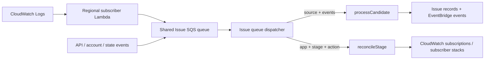

# Reduce SQS free-tier use by consolidating Issue queues

## Understanding

### Problem

SQS free-tier use reached **854,255 / 1,000,000 requests** as of October 20.

CloudWatch showed message metrics mostly at `0–2`, while
`NumberOfEmptyReceives` stayed near **30 per minute**. That rate explains the
reported usage:

```text
30 empty receives/minute × 60 × 24 × 20 days = 864,000 requests
```

The cost is idle polling, not message throughput.

### Verified current behavior

| Fact                                                                               | Evidence                                                                                             |
| ---------------------------------------------------------------------------------- | ---------------------------------------------------------------------------------------------------- |
| Two Issue SQS queues each have a Lambda subscription.                              | `infra/issue.ts`: `issueReconcileQueue.subscribe(...)` and `issueIngressQueue.subscribe(...)`        |
| Lambda event-source mappings poll queues when empty.                               | AWS Lambda SQS behavior; observed `NumberOfEmptyReceives` confirms it here.                          |
| Reconcile jobs send directly to the reconcile queue.                               | `packages/core/src/issue/monitoring.ts`: `enqueueReconcile()`                                        |
| Regional subscriber Lambdas send error-log candidates to the ingress queue.        | `packages/core/src/issue/subscriber-code.ts`                                                         |
| Ingress and reconciliation use separate queue handlers.                            | `packages/functions/src/events/issue-ingress.ts`; `packages/functions/src/events/issue-reconcile.ts` |
| API, account-event, and S3-state-event functions link to the reconcile queue.      | `infra/api.ts`; `infra/bus.ts`                                                                       |
| Ingress queue policy grants connected workload subscriber roles `sqs:SendMessage`. | `ensureIngressQueuePolicy()` in `packages/core/src/issue/monitoring.ts`                              |
| EventBridge already carries Console domain events.                                 | `infra/event-bus.ts`; `infra/bus.ts`                                                                 |

### Goal

Reduce baseline SQS requests below the monthly one-million free-tier allowance,
without changing Issue monitoring's cross-account ingress path, delayed
reconciliation, or durable queue semantics.

### Boundary

This change merges two queues into one. It does not replace SQS with
EventBridge, redesign monitoring, alter DynamoDB entities, or add EventBridge
Scheduler.

## Approach

Use one shared Issue queue and one SQS-to-Lambda subscription.

```text
Current:
IssueIngressQueue   → IssueIngressQueueSubscriber
IssueReconcileQueue → IssueReconcileQueueSubscriber

Target:
IssueQueue → IssueQueueSubscriber → dispatch ingress or reconcile work
```

### Key decisions

1. Keep the current ingress queue physical resource. In code, rename its
   exported symbol to `issueQueue`, but retain SST construct ID
   `"IssueIngressQueue"`. This avoids forcing connected workload accounts to
   update their deployed subscriber Lambda queue URLs during this change.
2. Delete the reconcile queue and its event-source mapping. This removes one
   permanently polling Lambda mapping.
3. Dispatch by validated message shape instead of introducing a new envelope.
   Existing ingress bodies are `{ source, events }`; reconciliation bodies are
   `{ appName, stageName, action, attempt }`. They are mutually exclusive.
   Retaining both producer contracts avoids a cross-account subscriber rollout.
4. Replace two handlers with one dispatcher. Its interface is an SQS record
   containing one valid Issue ingress or reconcile body; validation, routing,
   system actor setup, and retry behavior stay internal.
5. Do not move to standard EventBridge for this work. It removes idle SQS
   polls, but introduces custom-event charges, cross-account event-bus policy
   work, and does not supply current per-message delayed reconciliation.

### Expected result

One standard SQS event-source mapping should halve baseline polling:

```text
Current: ~30 empty receives/minute ≈ 1.30M/month
Target:  ~15 empty receives/minute ≈ 648k/month
```

AWS controls exact poller scaling. CloudWatch metrics are acceptance evidence,
not a fixed infrastructure guarantee.

## Implementation steps

### 1. Consolidate Issue queue infrastructure

**File:** `infra/issue.ts`

- Replace exports `issueIngressQueue` and `issueReconcileQueue` with
  `issueQueue`.
- Keep SST construct ID `"IssueIngressQueue"`.
- Remove reconcile queue resource.
- Replace both subscriptions with one queue subscription:

```ts
export const issueQueue = new sst.aws.Queue("IssueIngressQueue");

issueQueue.subscribe({
	handler: "packages/functions/src/events/issue-queue.handler",
	link: [bus, consoleData, consoleConnections, issueQueue],
	environment: {
		// Existing Issue configuration, with one queue URL.
	},
	permissions: [
		assumeAccountRolePermission,
		{
			actions: ["sqs:SetQueueAttributes"],
			resources: [issueQueue.arn]
		}
	]
});
```

- Change `issueEnvironment` to retain
  `SST_CONSOLE_ISSUE_QUEUE_ARN` and `SST_CONSOLE_ISSUE_QUEUE_URL`, and remove
  `SST_CONSOLE_ISSUE_RECONCILE_QUEUE_URL`.

### 2. Rewire queue-linked functions

**Files:** `infra/api.ts`, `infra/bus.ts`

- Replace imports and `link` entries for `issueReconcileQueue` with
  `issueQueue`.
- Preserve environment propagation through `issueEnvironment`.

This keeps API requests, account connection events, and S3 state events able to
enqueue reconciliation work.

### 3. Use a single queue configuration in monitoring

**File:** `packages/core/src/issue/monitoring.ts`

Replace separate ingress and reconcile URLs with one queue URL:

```ts
type IngressConfig = {
	controlAccountId: string;
	stage: string;
	queueArn: string;
	queueRegion: string;
	queueUrl: string;
};
```

Update `ingressConfig()` to read only `SST_CONSOLE_ISSUE_QUEUE_URL`.

Update `enqueueReconcile()`:

```ts
async function enqueueReconcile(input, delaySeconds = 0) {
	const config = ingressConfig();

	await new SQSClient({ region: config.queueRegion }).send(
		new SendMessageCommand({
			QueueUrl: config.queueUrl,
			MessageBody: JSON.stringify(input),
			DelaySeconds: delaySeconds
		})
	);
}
```

Update `ensureIngressQueuePolicy()` to set the policy on `config.queueUrl`.

Do not change `subscriberTemplate()` or `subscriberCode`: both already use
`SST_CONSOLE_ISSUE_QUEUE_URL`, which remains the stable shared queue URL.

### 4. Replace handlers with one dispatcher

**Delete:**

- `packages/functions/src/events/issue-ingress.ts`
- `packages/functions/src/events/issue-reconcile.ts`

**Add:** `packages/functions/src/events/issue-queue.ts`

Move the existing ingress and reconciliation Zod schemas into the dispatcher.
Validate each record, then route it:

```ts
export const handler: SQSHandler = async event => {
	for (const record of event.Records) {
		const body = JSON.parse(record.body);

		const ingress = IngressSchema.safeParse(body);
		if (ingress.success) {
			await withActor({ type: "system", properties: {} }, async () => {
				await processCandidate(ingress.data);
			});
			continue;
		}

		const reconcile = ReconcileSchema.safeParse(body);
		if (reconcile.success) {
			await Issue.Monitoring.reconcileStage(reconcile.data);
			continue;
		}

		throw new Error("Unsupported Issue queue message");
	}
};
```

Failure behavior:

- Invalid JSON, unknown bodies, invalid ingress candidates, and invalid
  reconciliation jobs throw.
- Lambda/SQS retains normal retry behavior.
- Existing producer payloads remain valid without producer changes.

### 5. Replace event handler tests

**Delete:** `packages/functions/tests/events/issue-ingress.test.ts`

**Add:** `packages/functions/tests/events/issue-queue.test.ts`

Cover:

- Valid ingress records call `processCandidate()` inside `withActor(system)`.
- Valid reconcile records call `Issue.Monitoring.reconcileStage()`.
- Mixed records dispatch in queue order.
- Unknown and invalid payloads reject for SQS retry.

### 6. Update monitoring tests

**File:** `packages/core/tests/issue/monitoring.test.ts`

- Retain regional-SQS-delivery assertions because SQS remains required for
  cross-account ingress.
- Update or add assertions for the one-queue environment contract where
  testable.

### 7. Deploy safely

Before deployment:

1. Confirm `IssueReconcileQueue` has no visible or in-flight messages.
2. If jobs remain, allow them to finish before queue removal.
3. Record empty-receive metrics for both queues.

After deployment:

1. Confirm one Issue event-source mapping remains.
2. Confirm `IssueReconcileQueue` no longer has a mapping.
3. Confirm the shared queue processes ingress and reconcile work.

No DynamoDB migration is required.

## Flow



## Validation

### Automated

Run from repository root:

```bash
bun run --cwd packages/functions test --run
bun run --cwd packages/core test --run
bun run check
```

### Acceptance criteria

- Exactly one `sst.aws.Queue` exists for Issue processing.
- Exactly one SQS Lambda event-source mapping exists for Issue processing.
- Existing regional subscriber Lambdas continue delivering ingress messages.
- Enabling or disabling monitored stages still queues and performs
  reconciliation.
- Delayed reconcile retries using `DelaySeconds: 60` still work.
- Invalid queue bodies fail visibly rather than being ignored.
- No DynamoDB schema or entity changes occur.
- `NumberOfEmptyReceives` falls from about 30/minute to about 15/minute after
  old mapping removal.
- Projected monthly baseline remains below one million SQS requests.

### Manual smoke checks

- Trigger one monitored Lambda error; verify an Issue is created.
- Connect and disconnect one monitored stage; verify its CloudWatch filter is
  added and removed.
- Check queue and Lambda dashboards for dispatcher failures and queue backlog.

## Risks and open questions

### Risks

1. **Pending reconcile jobs can be lost when old queue is removed.** Deploy
   only after it is empty. If that is not possible, request reconciliation for
   affected enabled stages after deployment.
2. **Shared batches can contain both message kinds.** Existing handlers retry
   whole batches on failure. Dispatcher preserves that behavior, but successful
   records can replay when another record fails. Existing Issue processing must
   remain safe under SQS at-least-once delivery.
3. **Physical resource name remains `IssueIngressQueue`.** This preserves
   existing cross-account subscriber delivery, but is less precise after
   consolidation.
4. **AWS controls poller scaling.** One mapping should halve baseline polling,
   but exact poll count is not configurable.

### Decisions requiring approval

1. Keep the existing ingress queue resource, or create a newly named
   `IssueQueue` resource?
    - Recommended: retain existing resource now, avoiding a connected-account
      subscriber rollout.
2. Is halving baseline use sufficient, or should later work replace SQS event
   mappings with scheduled queue draining?
3. Should a later improvement configure partial-batch responses to avoid
   replaying valid mixed records? This needs SST v4.16 event-source-mapping API
   confirmation and deliberately changes current retry behavior.
